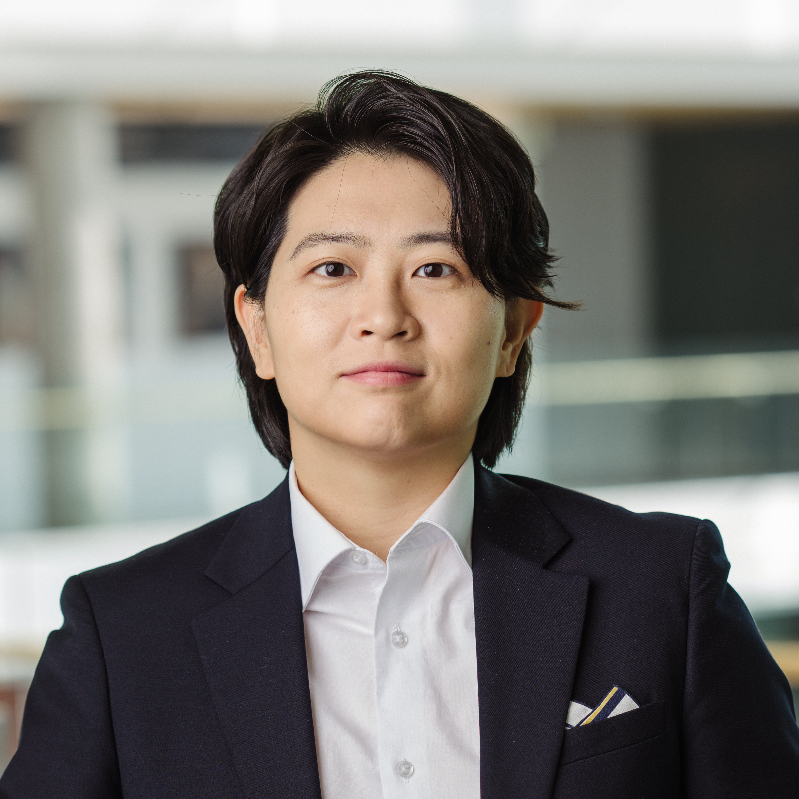

```{=html}
<div class="site-wrap">
  <div class="row g-0">

    <!-- ════════════════════════════════════════════════════
         SIDEBAR
         ════════════════════════════════════════════════════ -->
    <div class="col-12 col-md-3 sidebar-col">
      <div class="sidebar-inner">

        <!-- PHOTO — place photo.png in this folder -->
        

        <!-- NAME & TITLE -->
        <h1 class="profile-name">Jean Joohyun Oh</h1>
        <p class="profile-subtitle">
          Assistant Professor<br>
          Tepper School of Business<br>
          Carnegie Mellon University
        </p>

        <!-- Mobile toggle (JS-controlled, do not edit) -->
        <button class="sidebar-toggle" aria-expanded="false" aria-label="Toggle navigation menu">
          MENU <i class="bi bi-chevron-down"></i>
        </button>

        <!-- LINKS & NAV — visible on desktop; shown via MENU toggle on mobile.
             Icons: https://icons.getbootstrap.com
             Add a link by copying any <li> block below.
             Add a nav item by copying an <a> in the nav and adding a matching section below. -->
        <div class="sidebar-collapsible">
          <ul class="sidebar-links">
            <li>
              <a href="mailto:jjoh@cmu.edu">
                <i class="bi bi-envelope"></i> Email
              </a>
            </li>
            <li>
              <a href="https://www.linkedin.com/in/jeanoh" target="_blank" rel="noopener noreferrer">
                <i class="bi bi-linkedin"></i> LinkedIn
              </a>
            </li>
            <li>
              <a href="https://scholar.google.com/citations?user=Y7fv_WwAAAAJ&hl=en" target="_blank" rel="noopener noreferrer">
                <i class="bi bi-mortarboard"></i> Google Scholar
              </a>
            </li>
            <li>
              <a href="https://scholars.cmu.edu/26561-jean-joohyun-oh" target="_blank" rel="noopener noreferrer">
                <i class="bi bi-building"></i> CMU Faculty Page
              </a>
            </li>
            <!-- CV — place cv.pdf in this folder -->
            <li>
              <a href="cv.pdf" target="_blank" rel="noopener noreferrer">
                <i class="bi bi-file-earmark-pdf"></i> Curriculum Vitae
              </a>
            </li>
          </ul>
          <nav class="sidebar-nav">
            <a href="#about">About</a>
            <a href="#whats-new">What's New</a>
            <a href="#research">Research</a>
            <a href="#teaching">Teaching</a>
          </nav>
        </div>

      </div>
    </div><!-- /sidebar -->

    <!-- ════════════════════════════════════════════════════
         MAIN CONTENT
         ════════════════════════════════════════════════════ -->
    <div class="col-12 col-md-9 main-col">
      <div class="main-inner">
```

## About {#about}

I am an Assistant Professor of Organization Theory and Entrepreneurship at the Tepper School of Business, Carnegie Mellon University. I study the role of entrepreneurship in society, specifically how and when it operates as a channel for upward mobility and as a solution to social problems. My work has been published in peer-reviewed academic journals including *Management Science, PNAS*, and *Academy of Management Discoveries*, and has been covered by Harvard Business Review, Forbes, TechCrunch, and Scientific American.

<!-- My research examines (1) how individuals' socioeconomic origins affect their entrepreneurial outcomes, and (2) how entrepreneurs are motivated by creating social impact and solving specific problems like climate change. To answer these questions, I employ a variety of methods including field experiments, econometric analysis of archival data, and qualitative interviews. My recent work focuses on how the socioeconomic backgrounds of entrepreneurs and investors shape startup investor behaviors. This work was selected as a finalist for the 2023 Organization Science/INFORMS Dissertation Proposal Competition. -->

I received my PhD in Management at Columbia Business School, MS in Strategy and BBA from Seoul National University. I grew up in Upstate New York and Seoul, Korea, and currently live in Pittsburgh. When I am not doing research, I enjoy rowing, cross fit, and spending time with my dog Ravioli.

## What's New {#whats-new}

```{=html}
<!-- To add an item: copy one <li> block. Most recent first. -->
<ul class="news-list">
  <li>
    <span class="news-date">Mar 2026</span>
    <span>
      Invited seminar talk at Johns Hopkins Carey Business School.<br>
      Invited presentation at the Reversing the Arrow Conference in San Diego.
    </span>
  </li>
</ul>
```

## Research {#research}

```{=html}
<!-- To add a paper: copy one ::: paper block in the .qmd source. Most recent first.
     Format: bold title + year, authors (use [Name](url) for links), *italic venue*, then links.
     Use {.paper-link} on each link so JS opens it in a new tab automatically.

::: paper
**Title of Paper** (YEAR)

Author One, Author Two, Author Three

*Journal Name*

[Paper](https://url){.paper-link} [Other Link](https://url){.paper-link}
:::
-->
<h3 class="research-sub">Publications</h3>
<div class="paper-list">
```

::: paper
**Climate Change Framing and Innovator Attention: Evidence from an Email Field Experiment** (2023)

[Jorge Guzman](https://www.jorgeguzman.co/), Jean Joohyun Oh, [Ananya Sen](https://sites.google.com/view/ananyasen/home) (equal authorship)

*Proceedings of the National Academy of Sciences (PNAS)*

[Paper](https://www.pnas.org/doi/abs/10.1073/pnas.2213627120){.paper-link}
:::

::: paper
**Mapping the Class Ceiling: The Social Class Disadvantage for Attaining Management Positions** (2022)

[Paul Ingram](https://business.columbia.edu/faculty/people/paul-ingram), Jean Joohyun Oh

*Academy of Management Discoveries*

[Paper](https://journals.aom.org/doi/abs/10.5465/amd.2020.0030){.paper-link}
[Harvard Business Review](https://hbr.org/2021/01/the-forgotten-dimension-of-diversity){.paper-link}
:::

::: paper
**What Motivates Innovative Entrepreneurs? Evidence from a Global Field Experiment** (2020)

[Jorge Guzman](https://www.jorgeguzman.co/), Jean Joohyun Oh, [Ananya Sen](https://sites.google.com/view/ananyasen/home) (equal authorship)

*Management Science*

[Paper](https://pubsonline.informs.org/doi/abs/10.1287/mnsc.2020.3612){.paper-link}
[TechCrunch](https://techcrunch.com/2020/06/02/what-motivates-innovative-entrepreneurs-money-or-altruism/){.paper-link}
[Scientific American](https://www.scientificamerican.com/article/saving-the-world-inspires-more-female-founders/){.paper-link}
[Forbes](https://www.forbes.com/sites/adigaskell/2021/05/13/what-motivates-social-entrepreneurs/?sh=606871293e0f){.paper-link}
:::

```{=html}
</div>

<h3 class="research-sub">Working Papers & Works in Progress</h3>
<div class="paper-list">
```

::: paper
**Privilege or Humble Beginnings? Founder and Investor Social Class Origins in Startup Investment Decisions**

Jean Joohyun Oh

*Under Review*
:::

::: paper
**The Class Gap in Venture Capital Funding: The Effect of Elite Private School Pedigree**

Jean Joohyun Oh

*Working Paper*
:::

::: paper
**How Gen AI Affects Screening Outcomes of Asian Job Candidates**

with [Wyatt Lee](https://www.leewyatt.com/)

*Experimental design stage*
:::

::: paper
**How Founder Race and Class Interact to Shape Investor Interest: Evidence from an Email Field Experiment**

with [Melody Chang](https://www.melody-chang.com/) and [Siyu Yu](https://michiganross.umich.edu/faculty-research/faculty/siyu-yu)

*Experimental design stage*
:::

::: paper
**Who Builds AI Startups?**

with [Solène Delecourt](https://sites.google.com/berkeley.edu/solenedelecourt/home)

*Data collection stage*
:::


```{=html}
</div>
```

## Teaching {#teaching}

```{=html}
<!-- Carnegie Mellon -->
<h3 class="teaching-sub">Carnegie Mellon University <span class="teaching-role">(Instructor)</span></h3>
<ul class="course-list">
  <li>
    <span class="course-num">47-889</span>
    <span class="course-name">Proseminar in Organizational Research</span>
    <span class="course-level">PhD</span>
    <span class="course-terms">Spr 2026</span>
  </li>
  <li>
    <span class="course-num">70-415</span>
    <span class="course-name">Introduction to Entrepreneurship</span>
    <span class="course-level">Undergrad</span>
    <span class="course-terms">Fall 2025 · Fall 2024</span>
  </li>
</ul>

<!-- Columbia (Teaching Assistant) -->
<h3 class="teaching-sub">Columbia Business School <span class="teaching-role">(Teaching Assistant)</span></h3>
<ul class="course-list">
  <li>
    <span class="course-name">Technology Strategy <span class="teaching-role"> - Dan Wang, Jerry Kim</span></span>
    <span class="course-level">MBA · EMBA</span>
    <span class="course-terms">2022-2024</span>
  </li>
  <li>
    <span class="course-name">Entrepreneurial Strategy <span class="teaching-role"> - Jorge Guzman</span></span>
    <span class="course-level">MBA</span>
    <span class="course-terms">2023 · 2020</span>
  </li>
  <li>
    <span class="course-name">Foundations of Entrepreneurship <span class="teaching-role"> - Damon Phillips</span></span>
    <span class="course-level">MBA</span>
    <span class="course-terms">2020</span>
  </li>
  <li>
    <span class="course-name">Leadership and Organizational Change <span class="teaching-role"> - Paul Ingram</span></span>
    <span class="course-level">EMBA</span>
    <span class="course-terms">2018-2021</span>
  </li>
  <li>
    <span class="course-name">Power &amp; Influence <span class="teaching-role"> - Eric Abrahamson</span></span>
    <span class="course-level">EMBA</span>
    <span class="course-terms">2018-2020</span>
  </li>
</ul>
```

```{=html}
      </div>
    </div><!-- /main -->

  </div>

  <!-- FOOTER — update the year -->
  <footer class="site-footer">
    <p>&copy; 2026 Jean Joohyun Oh</p>
  </footer>
</div>
```
