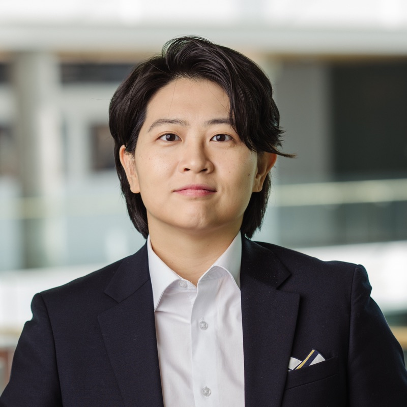

```{=html}
<!-- ════════════════════════════════════════════════════
     TOP BAR
     ════════════════════════════════════════════════════ -->
<header class="topbar">
  <div class="wrap">
    <a class="brand" href="#top">Jean Joohyun Oh</a>
    <nav class="topnav" aria-label="Sections">
      <a href="#about">About</a>
      <a href="#whats-new">News</a>
      <a href="#research">Research</a>
      <a href="#teaching">Teaching</a>
      <a class="cv" href="cv.pdf" target="_blank" rel="noopener noreferrer">CV <span class="ext">↗</span></a>
    </nav>
  </div>
</header>

<main class="wrap" id="top">

<!-- ════════════════════════════════════════════════════
     INTRO — photo.jpg lives in this folder
     ════════════════════════════════════════════════════ -->
<section class="intro">
  
  <div>
    <div class="name" role="heading" aria-level="1">Jean Joohyun Oh</div>
    <p class="title">
      Assistant Professor of Organizational Theory &amp; Entrepreneurship<br>
      Tepper School of Business, Carnegie Mellon University
    </p>
    <!-- Add a link by copying any <li> below. -->
    <ul class="links">
      <li>
        <a href="mailto:jjoh@cmu.edu">
          <svg viewBox="0 0 24 24" fill="none" stroke="currentColor" stroke-width="1.8" aria-hidden="true"><rect x="3" y="5" width="18" height="14" rx="2"/><path d="M3 7l9 6 9-6"/></svg>jjoh@cmu.edu
        </a>
      </li>
      <li><a href="https://scholar.google.com/citations?user=Y7fv_WwAAAAJ&amp;hl=en" target="_blank" rel="noopener noreferrer">Google Scholar <span class="ext">↗</span></a></li>
      <li><a href="https://www.linkedin.com/in/jeanoh" target="_blank" rel="noopener noreferrer">LinkedIn <span class="ext">↗</span></a></li>
      <li><a href="https://scholars.cmu.edu/26561-jean-joohyun-oh" target="_blank" rel="noopener noreferrer">CMU faculty page <span class="ext">↗</span></a></li>
      <li><a href="cv.pdf" target="_blank" rel="noopener noreferrer">Curriculum vitae <span class="ext">↗</span></a></li>
    </ul>
  </div>
</section>
```

## About {#about}

::: {.sec-body .prose}
I am an Assistant Professor of Organization Theory and Entrepreneurship at the Tepper School of Business, Carnegie Mellon University. I study the role of entrepreneurship in society, specifically how and when it operates as a channel for upward mobility and as a solution to social problems. My work has been published in peer-reviewed academic journals including *Management Science, PNAS*, and *Academy of Management Discoveries*, and has been covered by Harvard Business Review, Forbes, TechCrunch, and Scientific American.

<!-- My research examines (1) how individuals' socioeconomic origins affect their entrepreneurial outcomes, and (2) how entrepreneurs are motivated by creating social impact and solving specific problems like climate change. To answer these questions, I employ a variety of methods including field experiments, econometric analysis of archival data, and qualitative interviews. My recent work focuses on how the socioeconomic backgrounds of entrepreneurs and investors shape startup investor behaviors. This work was selected as a finalist for the 2023 Organization Science/INFORMS Dissertation Proposal Competition. -->

I received my PhD in Management at Columbia Business School, MS in Strategy and BBA from Seoul National University. I grew up in Upstate New York and Seoul, Korea, and currently live in Pittsburgh. When I am not doing research, I enjoy rowing and spending time with my dog Ravioli.
:::

## What's New {#whats-new}

::: sec-body
```{=html}
<!-- To add an item: copy one <li> block. Most recent first. -->
<ul class="news">
  <li>
    <time>Mar 2026</time>
    <span>Invited seminar talk at Johns Hopkins Carey Business School.</span>
  </li>
  <li>
    <time>Mar 2026</time>
    <span>Invited presentation at the Reversing the Arrow Conference in San Diego.</span>
  </li>
</ul>
```
:::

## Research {#research}

:::: sec-body
```{=html}
<!-- To add a paper: copy one ::: paper block below. Most recent first.
     Line 1: bold title, then the year as [YEAR]{.yr} (omit for working papers)
     Line 2: authors (use [Name](url) for links), or "Solo-authored"
     Line 3: *italic venue or status*
     Line 4 (optional): links, each tagged {.paper-link} so it opens in a new tab

::: paper
**Title of Paper** [YEAR]{.yr}

Author One, Author Two

*Journal Name*

[Paper](https://url){.paper-link} [Other Link](https://url){.paper-link}
:::
-->
<div class="sub">Publications</div>
<div class="group">
```

::: paper
**Climate Change Framing and Innovator Attention: Evidence from an Email Field Experiment** [2023]{.yr}

[Jorge Guzman](https://www.jorgeguzman.co/), Jean Joohyun Oh, [Ananya Sen](https://sites.google.com/view/ananyasen/home) (equal authorship)

*Proceedings of the National Academy of Sciences (PNAS)*

[Paper](https://www.pnas.org/doi/abs/10.1073/pnas.2213627120){.paper-link}
:::

::: paper
**Mapping the Class Ceiling: The Social Class Disadvantage for Attaining Management Positions** [2022]{.yr}

[Paul Ingram](https://business.columbia.edu/faculty/people/paul-ingram), Jean Joohyun Oh

*Academy of Management Discoveries*

[Paper](https://journals.aom.org/doi/abs/10.5465/amd.2020.0030){.paper-link}
[Harvard Business Review](https://hbr.org/2021/01/the-forgotten-dimension-of-diversity){.paper-link}
:::

::: paper
**What Motivates Innovative Entrepreneurs? Evidence from a Global Field Experiment** [2020]{.yr}

[Jorge Guzman](https://www.jorgeguzman.co/), Jean Joohyun Oh, [Ananya Sen](https://sites.google.com/view/ananyasen/home) (equal authorship)

*Management Science*

[Paper](https://pubsonline.informs.org/doi/abs/10.1287/mnsc.2020.3612){.paper-link}
[TechCrunch](https://techcrunch.com/2020/06/02/what-motivates-innovative-entrepreneurs-money-or-altruism/){.paper-link}
[Scientific American](https://www.scientificamerican.com/article/saving-the-world-inspires-more-female-founders/){.paper-link}
[Forbes](https://www.forbes.com/sites/adigaskell/2021/05/13/what-motivates-social-entrepreneurs/?sh=606871293e0f){.paper-link}
:::

```{=html}
</div>

<div class="sub">Working papers &amp; selected works in progress</div>
<div class="group">
```

::: paper
**Privilege or Humble Beginnings? Founder and Investor Social Class Origins in Startup Investment Decisions**

Solo-authored

*Working paper*
:::

::: paper
**The Class Gap in Venture Capital Funding: The Effect of Elite Private School Pedigree**

Solo-authored

*Under review*
:::

::: paper
**How Gen AI Affects Screening Outcomes of Asian Job Candidates**

with [Wyatt Lee](https://www.leewyatt.com/)

*Experimental design stage*
:::

```{=html}
</div>
```
::::

## Teaching {#teaching}

::: sec-body
```{=html}
<!-- To add a course: copy one <li>. Use class="nonum" when there is no course number. -->
<div class="teach">
  <h3>Carnegie Mellon University <span class="role">Instructor</span></h3>
  <ul class="courses">
    <li>
      <span class="num">47-892</span>
      <span>Seminar in Organizational Theory</span>
      <span class="meta"><b>PhD</b>Fall 2026</span>
    </li>
    <li>
      <span class="num">47-889</span>
      <span>Proseminar in Organizational Research</span>
      <span class="meta"><b>PhD</b>Spring 2026</span>
    </li>
    <li>
      <span class="num">70-415</span>
      <span>Introduction to Entrepreneurship</span>
      <span class="meta"><b>Undergrad</b>Fall 2026 · Fall 2025 · Fall 2024</span>
    </li>
  </ul>
</div>

<div class="teach">
  <h3>Columbia Business School <span class="role">Teaching assistant</span></h3>
  <ul class="courses">
    <li class="nonum">
      <span>Technology Strategy <span class="who">· Dan Wang, Jerry Kim</span></span>
      <span class="meta"><b>MBA · EMBA</b>2022–2024</span>
    </li>
    <li class="nonum">
      <span>Entrepreneurial Strategy <span class="who">· Jorge Guzman</span></span>
      <span class="meta"><b>MBA</b>2023 · 2020</span>
    </li>
    <li class="nonum">
      <span>Foundations of Entrepreneurship <span class="who">· Damon Phillips</span></span>
      <span class="meta"><b>MBA</b>2020</span>
    </li>
    <li class="nonum">
      <span>Leadership and Organizational Change <span class="who">· Paul Ingram</span></span>
      <span class="meta"><b>EMBA</b>2018–2021</span>
    </li>
    <li class="nonum">
      <span>Power &amp; Influence <span class="who">· Eric Abrahamson</span></span>
      <span class="meta"><b>EMBA</b>2018–2020</span>
    </li>
  </ul>
</div>
```
:::

```{=html}
</main>

<!-- FOOTER — update the year -->
<footer class="footbar">
  <div class="wrap"><span class="copy">© 2026 Jean Joohyun Oh</span></div>
</footer>
```
